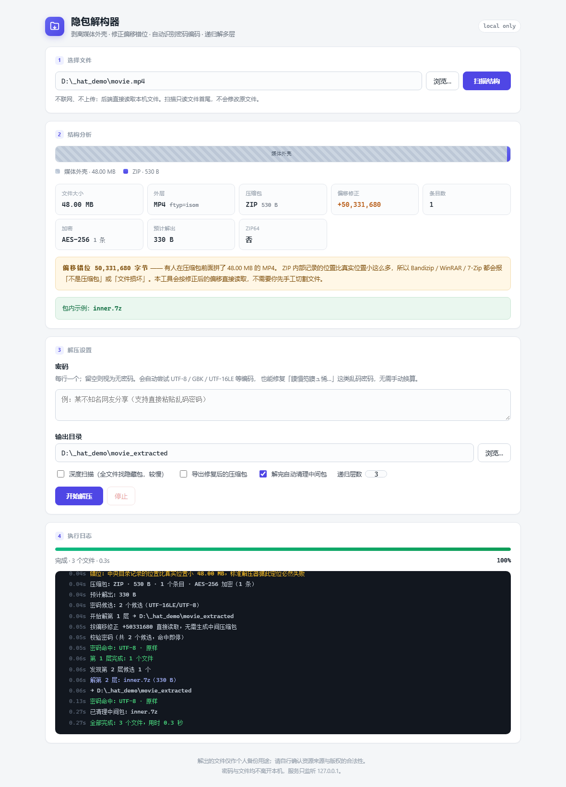

# 隐包解构器 · HiddenArchiveTool

**剥离媒体外壳、修复偏移错位、自动识别密码编码、递归解多层** —— 一个本地运行的小工具，专门对付「MP4 改 ZIP」这类伪装资源。

[](https://github.com/wxc45/HiddenArchiveTool/actions/workflows/smoke.yml)
[](https://www.python.org/)
[](LICENSE)




---

## 它解决什么问题

网盘里拿到的 `xxx.mp4`，其实是「视频外壳 + 加密 ZIP + 内层 7z」。
Bandizip / WinRAR / 7-Zip 打开全报 **「不是压缩包」「密码错误」「文件损坏」**，
但文件其实是好的 —— 卡在下面三件事上。

### 1. 偏移错位：ZIP 内部记录的位置整体偏了

ZIP 的中央目录里存的是**相对于压缩包起点**的偏移。有人在压缩包前面拼了一段视频，
所有偏移就整体偏移一个固定值，解压器按记录值去读，读到的全是视频里的随机数据。

本工具用「中央目录的**真实位置** − **记录位置**」反推出错位量 `shift`，
之后所有定位都加上它。**不需要先手工把文件切成两半**，也不生成几 GB 的中间包，
直接按修正后的偏移流式读取。

### 2. 密码编码：同一句话，两边算出的密钥不同

同一句 `某不知名网友分享`：

- 7-Zip 按 **UTF-8** 字节参与 PBKDF2
- 中文系统的 Bandizip 按 **GBK**

编码不一致 → 校验值天然对不上 → 永远提示「密码错误」，即使你输的就是对的。

工具会把输入展开成 UTF-8 / GBK / GB18030 / UTF-16LE / Latin1 多个候选，
再读 ZIP 条目开头的 2 字节校验值（`pv`）**毫秒级判定**，并告诉你到底是哪种编码命中。

还顺带处理「乱码密码」：`鏌愪笉鐭ュ悕缃戝弸鍒嗕韩` 是 UTF-8 字节被 GBK 误读的结果，
直接贴进去会自动还原成 `某不知名网友分享`。

### 3. 多层嵌套

外壳里通常不是一层：ZIP 里放 7z，7z 里才是真正的文件。
工具解完一层会自动在输出目录里找下一层，按魔数判断（不看扩展名），
遇到 APK / JAR / DOCX 这类「本质是 ZIP 但属于安装包、文档」的容器会主动跳过，
避免把目录拆得七零八落。

---

## 特性

| 能力 | 说明 |
|---|---|
| 伪装文件识别 | 媒体外壳 + 尾部压缩包，自动算出起止偏移 |
| 偏移错位修复 | 按 `shift` 修正，无需切割文件、无中间产物 |
| 加密 ZIP | 无加密 / WinZip AES-128/192/256 / 传统 ZipCrypto |
| 密码编码自适应 | 5 种编码候选 + 乱码还原，`pv` 秒判并报告命中编码 |
| 7z / RAR | 调用 7-Zip，中文密码可用 |
| 递归多层 | 默认 3 层，自动跳过容器格式，解完可清理中间包 |
| 完整性校验 | 逐条目 CRC32 校验，异常单独列出 |
| 界面 | 本地网页，结构分段可视化 + 实时日志，不联网、不上传 |

---

## 快速开始

### Windows（推荐）

**双击 `run.bat`**。启动器会自动：找可用的 Python（优先 `py -3`，并跳过 Microsoft Store 的假 `python.exe`）→ 缺依赖就装（默认源失败自动切清华镜像）→ 检测 7-Zip → 起服务并打开浏览器。

### 任意平台

```bash
pip install -r requirements.txt
python launcher.py      # 带中文诊断
# 或
python app.py           # 直接起服务
```

打开 `http://127.0.0.1:8770`（端口被占用会自动顺延）。

**依赖**：Python 3.9+、`flask`、`pycryptodome`；解 `.7z` / `.rar` 需要装 [7-Zip](https://www.7-zip.org/)（解 ZIP 不需要）。

---

## 使用

1. 粘贴或选择文件 → **扫描结构**：给出分段条（媒体外壳 / 压缩包 / 残留）、偏移错位量、条目数、加密方式、预计解出体积，并直接说明标准工具为什么打不开
2. 填密码（可留空）→ **开始解压**：实时日志会写明密码命中的编码
3. 结果默认输出到同级 `<文件名>_extracted`

也支持带参打开，方便做快捷方式或右键菜单：

```
http://127.0.0.1:8770/?path=D:\xxx\movie.mp4&pw=密码&auto=1
http://127.0.0.1:8770/?job=<任务号>     # 刷新页面不丢进度和日志
```

---

## 实现要点

几个踩过的坑，写在这里省得别人再踩：

**CTR 计数器**：WinZip AES 用的是「从 1 开始的小端计数器」，即 `AES(LE(1+i))`，不是拿 nonce 当初始计数器。用错会解出乱码，但密码校验值 `pv` 依然通过 —— 很容易误判成「密码错」。

**认证码不可信**：AES 条目末尾 10 字节的 HMAC 认证码，连 7-Zip 自己造出来的包都对不上，所以完整性只认条目里的 CRC32。

**CRC 可能为 0**：7-Zip 创建 AES 条目时会把中央目录里的 CRC 写成 0（表示未记录），校验逻辑必须把 0 视为「未提供」，否则全部误报失败。

**ZIP64 判据**：7-Zip 即使字段放得下也会写 ZIP64 记录，所以判断不能只看 EOCD 里的 `0xFFFF` 哨兵，必须检查 EOCD 前 20 字节是否为 ZIP64 定位器（`PK\x06\x07`），否则中央目录起点会算错，整个包识别失败。

**诱饵签名**：打包者常在压缩包结尾贴一串假 `Rar!` 头来误导排查，判据是「长度很小且紧贴前一压缩包结尾」。

---

## 目录结构

```
HiddenArchiveTool/
├─ run.bat              双击入口（纯 ASCII + CRLF，只负责找 python）
├─ launcher.py          中文提示、依赖自检与安装、7-Zip 检测
├─ app.py               Flask 路由、任务线程、进度与日志
├─ core/
│  ├─ probe.py          结构探测：EOCD/ZIP64 解析、偏移错位计算、诱饵识别
│  ├─ zipkit.py         带偏移修正的 ZIP 读取 + AES/ZipCrypto 解密
│  ├─ passwords.py      密码候选生成（多编码 + 乱码修复）
│  └─ extractor.py      解压编排：ZIP 自研、7z/RAR 走 7-Zip、递归、清理
├─ templates/index.html
├─ static/style.css · app.js
├─ tests/test_smoke.py  冒烟测试（不需要 7-Zip，不联网）
├─ docs/screenshot.png
└─ requirements.txt
```

## 测试

```bash
python tests/test_smoke.py     # 也可以 pytest tests/
```

CI 在 Ubuntu 与 Windows 上跑 Python 3.9 / 3.12。

---

## 常见问题

**双击 run.bat 窗口一闪就没了**

旧版本这个问题有两个原因，现已修复：批处理曾是 UTF-8 + LF 换行，而 `cmd.exe` 按 GBK 逐行解析，
中文和换行都会让它把脚本读坏，于是明明装了 Python 也走「未找到」分支。
现在 `run.bat` 是 **纯 ASCII + CRLF**，只负责找解释器，中文提示全部交给 Python 输出。

仍然起不来就用命令行跑 `python launcher.py`，报错会完整打印。

**能开界面但提示未找到 7-Zip**：装个 [7-Zip](https://www.7-zip.org/) 即可，解 ZIP 不受影响。

**解出来的文件比预期少**：看日志里的「跳过 N 个容器格式」，APK/JAR/DOCX 默认不展开。

---

## 已知限制

- 只处理单个文件，不批量（批量可循环调用 `core.extractor.run`）
- 服务只监听 `127.0.0.1`，不联网、不上传文件
- 不支持分卷压缩包（`.001/.002`、`.part1.rar`）
- 没有断点续解，中断后重跑会从头开始

---

## English

A local web tool for extracting archives disguised as media files
(`.mp4` renamed to `.zip` and similar tricks), including the multi-layer
nesting that usually comes with them.

Two problems make these files look broken to every standard archiver:

1. **Offset shift** — the ZIP central directory stores offsets relative to the
   archive start. Prepending a video shifts every offset by a constant, so
   readers land on random media bytes. This tool derives the shift from
   *(real central-directory position − recorded position)* and reads the
   archive in place, with no intermediate copy.
2. **Password encoding** — 7-Zip derives the key from UTF-8 bytes while
   Chinese-locale Bandizip uses GBK, so a correct password still fails.
   The tool tries UTF-8 / GBK / GB18030 / UTF-16LE / Latin1 (plus mojibake
   repair) and verifies against the 2-byte AES password-verifier in
   milliseconds.

Supports plain, WinZip AES-128/192/256 and ZipCrypto ZIPs, 7z/RAR via 7-Zip,
recursive layers, and per-entry CRC32 verification. A Windows launcher is
included; `python launcher.py` works anywhere.

MIT licensed.

---

## 免责声明

本工具只做本地文件的结构解析与解压，不提供、不传播任何内容。
解出的可执行文件请自行确认来源与安全性（建议先杀毒扫描），
资源的使用请遵守当地法律与原始授权。
